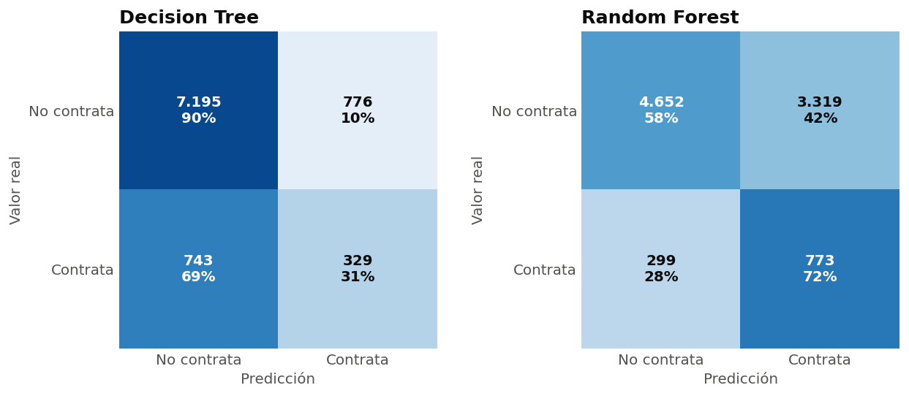
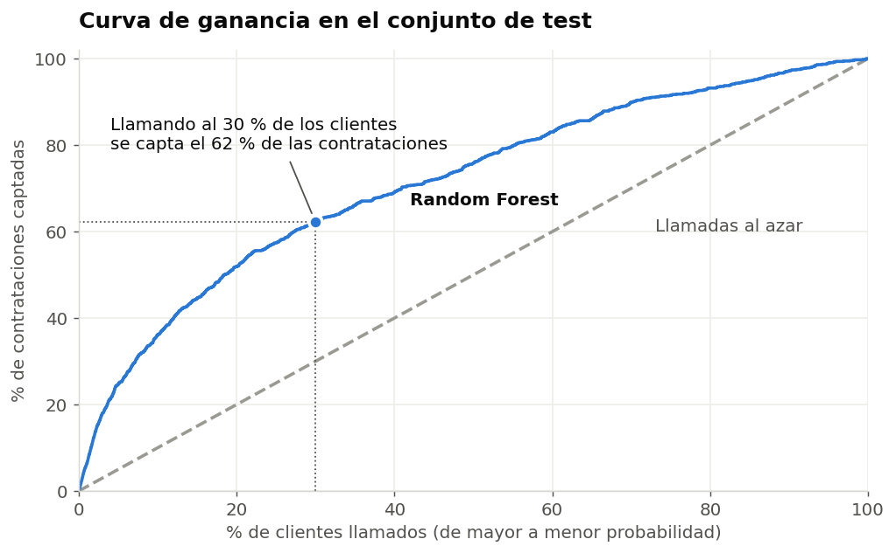
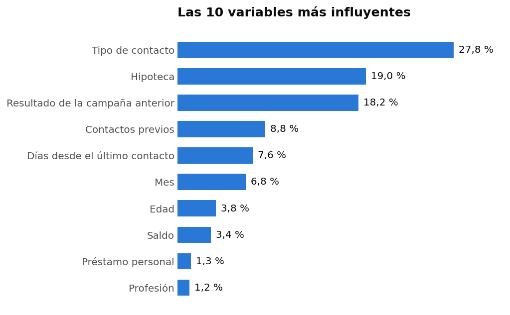

 

## El problema

Un banco quiere dirigir su campaña telefónica solo a los clientes con más probabilidad de contratar un depósito a plazo, para no gastar llamadas (ni molestar) en los que no lo harán.

 

## Los datos

[Bank Marketing (UCI Machine Learning Repository)](https://archive.ics.uci.edu/dataset/222/bank+marketing), fichero `bank-full.csv`. Licencia CC BY 4.0.

Referencia: S. Moro, P. Cortez y P. Rita (2014). *A Data-Driven Approach to Predict the Success of Bank Telemarketing*. Decision Support Systems.

 

## Enfoque

- **Sin fuga de información**: se excluye `duration` (duración de la llamada), porque solo se conoce cuando la llamada ya ha terminado y no está disponible al decidir a quién llamar.
- **Preprocesado**: escalado `MinMaxScaler` en las variables numéricas, e imputación y `OneHotEncoder` en las categóricas.
- Uso de **Pipelines** de scikit-learn para encadenar preprocesado y modelo y evitar fuga de datos.
- **Modelos**: Decision Tree y Random Forest con `class_weight="balanced"`, ya que solo contrata alrededor del 12 % de los clientes. Se evalúan con un 20 % de datos reservado para test (9.043 clientes).

 

## Resultados

Métricas de la clase **"contrata"** en el conjunto de test:

| Modelo | Recall | Precisión | F1 | Accuracy |
|---|---|---|---|---|
| Decision Tree | 31 % | 30 % | 0,30 | 83 % |
| **Random Forest** | **72 %** | **19 %** | **0,30** | 60 % |

El Decision Tree acierta más en global porque predice sobre todo "no contrata", la clase mayoritaria. Para una campaña interesa más el **Random Forest**: encuentra a 773 de los 1.072 clientes que contratan, frente a 329.

{fig-alt="Matrices de confusión. Decision Tree: 7.195 verdaderos negativos, 776 falsos positivos, 743 falsos negativos y 329 verdaderos positivos. Random Forest: 4.652, 3.319, 299 y 773."}

### ¿A quién conviene llamar?

El modelo ordena a los clientes por probabilidad de contratar. **Llamando solo al 30 % con mayor probabilidad se capta el 62 % de las contrataciones**, aproximadamente el doble que llamando al azar.

{fig-alt="Curva de ganancia del Random Forest frente a llamadas al azar. Llamando al 30 % de los clientes se capta el 62 % de las contrataciones."}

### Qué variables pesan más

El tipo de contacto, tener hipoteca y el resultado de la campaña anterior concentran cerca de dos tercios de la importancia del modelo. Indican qué usa el modelo para predecir, no necesariamente qué causa la contratación.

{fig-alt="Barras con las 10 variables más influyentes. Las primeras son tipo de contacto (27,8 %), hipoteca (19,0 %) y resultado de la campaña anterior (18,2 %)."}

### Recomendación para el banco

Usar la probabilidad del Random Forest para **priorizar la lista de llamadas** y fijar el corte según el presupuesto de la campaña. Aun así, la mayoría de las llamadas a clientes señalados no acabará en contratación (precisión del 19 %, frente al 11,9 % al azar), así que el modelo sirve para ordenar el esfuerzo, no para asegurar ventas.

 

## Código

- [Ver el notebook completo](../bank_marketing_pipe.ipynb)
- [Repositorio en GitHub](https://github.com/juan1639/Bank_marketing_notebook){target="_blank" rel="noopener"}
